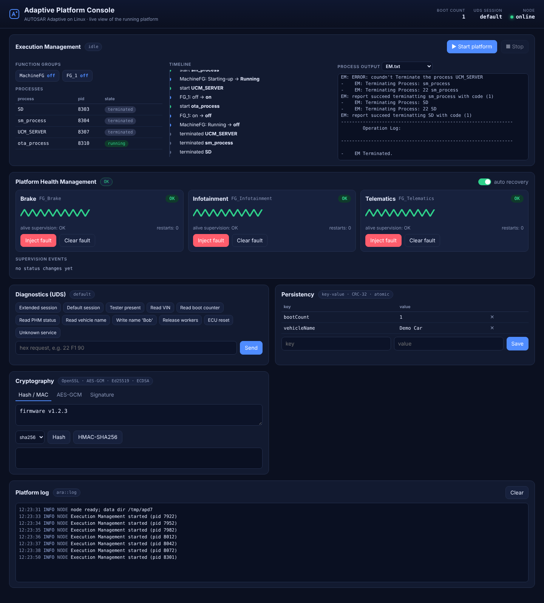
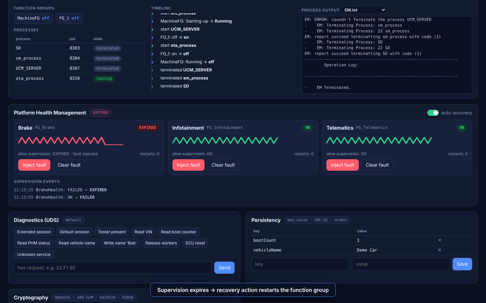
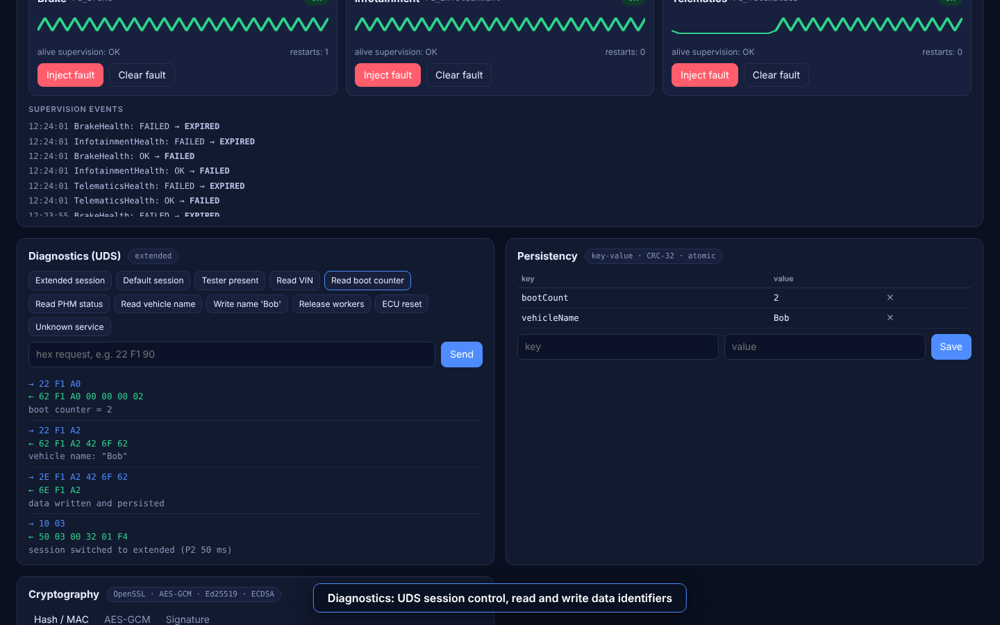
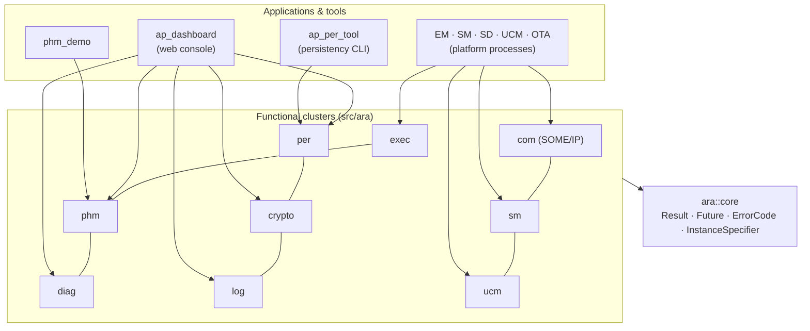

<div align="center">

# Adaptive Platform

**An open implementation of the [AUTOSAR Adaptive Platform](https://www.autosar.org/standards/adaptive-platform) on Linux** —
functional clusters (`ara::*`), platform processes, tools, and a live web console.

[](https://github.com/ahmed192a/Adaptive-Platform/actions/workflows/master.yml)


-orange)



</div>

## Contents

[Quick start](#quick-start) · [The console](#the-console) · [Architecture](#architecture) · [Cluster status](#cluster-status) ·
[Building](#building) · [Testing](#testing) · [Repository layout](#repository-layout) · [Legacy scripts](#legacy-quick-test-scripts)

## Quick start

```bash
git clone https://github.com/ahmed192a/Adaptive-Platform && cd Adaptive-Platform
cmake --preset debug                 # needs CMake ≥ 3.21 for presets; or: cmake -S . -B build
cmake --build --preset debug -j
ctest --preset debug                 # ~170 tests

# run the platform with its web console
./build/debug/App/dashboard/ap_dashboard --port 8080      # then open http://127.0.0.1:8080
```

Requirements: a C++17 compiler (GCC ≥ 9 or Clang ≥ 10), CMake, Ninja (for presets) and OpenSSL
development files (optional — `ara::crypto` is skipped without them). GoogleTest, nlohmann/json, spdlog and
CLI11 are fetched automatically (`-DAP_USE_SYSTEM_DEPS=ON` prefers installed copies).

## The console

`ap_dashboard` hosts the new clusters in one process, drives the real **Execution Management** (which starts the
SD / SM / UCM / OTA processes from the manifests) and serves a single-page console.
See **[doc/dashboard.md](doc/dashboard.md)** for the walkthrough, screenshots and the demo video.

| Execution Management | Health Management | Diagnostics |
|---|---|---|
|  |  |  |

Record your own demo (it doubles as an end-to-end test of the platform):

```bash
./build/debug/App/dashboard/ap_dashboard --port 8099 &
pip install playwright && python3 Tools/demo/record_demo.py --out doc/img --video
```

## Architecture



Design rules for the new clusters: exception-free `ara::core::Result` APIs, injected clocks for deterministic
tests, no global state beyond what the spec requires (lifecycle hooks run in `ara::core::Initialize()`),
strict warnings (`-Werror`) and unit tests with every cluster.

## Cluster status

| Cluster | State | Highlights |
|---|---|---|
| `ara::core` | ✅ rewritten | `Result`, `Future/Promise`, `ErrorCode/Domain`, `InstanceSpecifier`, init/deinit hooks |
| `ara::log` | ✅ new | `Logger`, `LogStream`, `Hex/Bin`, console/file sinks |
| `ara::per` | ✅ new | key-value + file storage, CRC-32, atomic persist with backup, quotas, JSON deployment config |
| `ara::phm` | ✅ new | alive / deadline / logical supervision, global supervision, recovery actions, watchdog escalation |
| `ara::diag` | 🟡 UDS core | session layer, S3 timer, `0x10 0x11 0x22 0x2E 0x3E`, DIDs, custom services |
| `ara::nm` | ✅ new | NM state machine, partial networks, NM PDU codec, injectable clock ([doc](doc/nm.md)) |
| `ara::crypto` | 🟡 primitives | RNG, SHA-2, HMAC, AES-GCM, Ed25519, ECDSA-P256, zeroizing keys, key store |
| `ara::exec` | 🟡 hardened | safe manifest parsing, client error reporting; EM process uses it |
| `ara::com` | 🟠 legacy | SOME/IP + service discovery |
| `ara::sm`, `ara::ucm` | 🟠 legacy | state management, update & configuration management |
| NM, TSync, IDSM, Firewall, … | ⬜ planned | see [doc/ROADMAP.md](doc/ROADMAP.md) |

The detailed gap analysis against AUTOSAR R25-11, known deviations and next steps are in
**[doc/ROADMAP.md](doc/ROADMAP.md)**.

## Building

| Preset | Purpose |
|---|---|
| `debug` / `release` | everyday builds |
| `asan` | AddressSanitizer + UBSan |
| `coverage` | gcov instrumentation (used by CI) |
| `ci` | Release with warnings as errors |

| Option | Default | Meaning |
|---|---|---|
| `AP_BUILD_TESTS` / `APPS` / `TOOLS` / `EXAMPLES` | ON (top level) | what to build |
| `AP_BUILD_CRYPTO` | ON | build `ara::crypto` when OpenSSL is found |
| `AP_BUILD_SHARED` | ON | shared vs static cluster libraries |
| `AP_ENABLE_SANITIZERS` / `AP_ENABLE_COVERAGE` | OFF | instrumentation |
| `AP_WARNINGS_AS_ERRORS` | ON | `-Werror` for new/migrated clusters |
| `AP_USE_SYSTEM_DEPS` | OFF | prefer `find_package` over downloads |
| `AP_INSTALL` | ON (top level) | generate install rules and the CMake package |

Use it from another project:

```cmake
find_package(AdaptivePlatform REQUIRED)
target_link_libraries(my_app PRIVATE AdaptivePlatform::core AdaptivePlatform::phm AdaptivePlatform::per)
```

Add a new cluster: create `src/ara/<name>/CMakeLists.txt` containing
`ap_add_cluster(NAME <name> DEPENDS ara_core_lib)`, tests in `Testing/<name>/` with `ap_add_test(...)`.

## Testing

```bash
ctest --preset debug                    # everything
ctest --preset debug -L phm             # one cluster (labels: core log per phm diag nm crypto exec dashboard legacy)
ctest --preset asan                     # sanitizers
```

CI (`.github/workflows/master.yml`) builds with GCC and Clang, runs the sanitizer and coverage jobs, runs the
end-to-end console scenario in a browser (screenshots and video are uploaded as artifacts) and publishes the
Doxygen documentation from `master`.

## Repository layout

```
src/ara/<cluster>/    functional clusters (core log per phm diag crypto exec com sm ucm …)
App/                  platform processes (EM, SM, SD, UCM, OTA), examples, dashboard
Tools/                command line tools (ap_per_tool), generators, demo recorder
Testing/              unit tests per cluster
cmake/                build system modules (options, warnings, dependencies, clusters)
doc/                  roadmap, dashboard guide, screenshots, Doxygen configuration
```

## Legacy quick-test scripts

The original helper scripts still work (`quick_test/`): `./configure.sh`, `./build.sh`, `./run.sh`, `./test.sh`,
`./sd_test.sh`. They use the same CMake project underneath.
