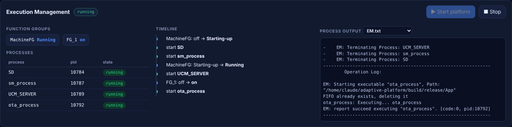
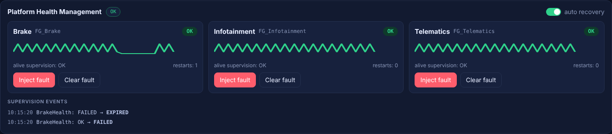
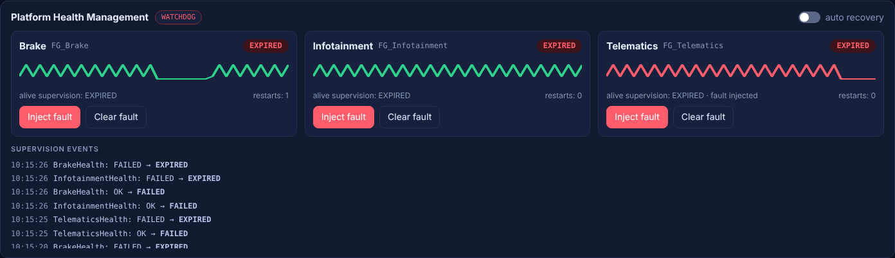
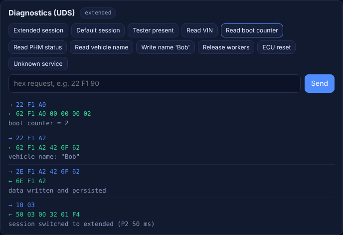
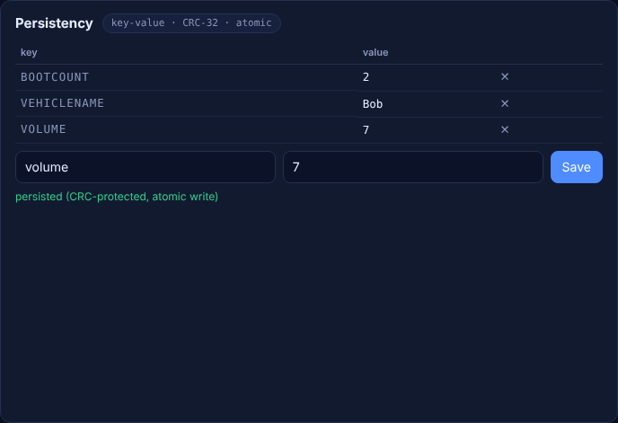
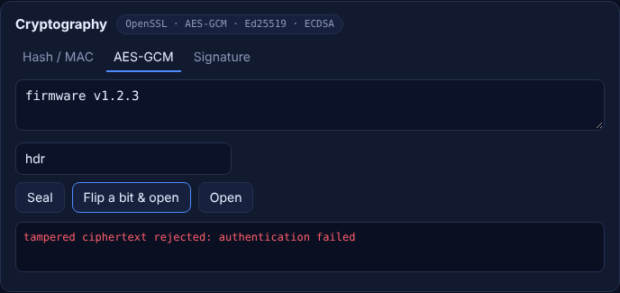

# Adaptive Platform Console

`ap_dashboard` is a self-contained demo node: it hosts the new clusters (`ara::phm`, `ara::diag`, `ara::per`,
`ara::crypto`, `ara::log`) and controls the legacy **Execution Management** process, then serves a web UI
and a small JSON API. It is meant for local demos and for end-to-end testing — it binds to `127.0.0.1` by default
and has no authentication, so do not expose it to a network.

```bash
ap_dashboard [--port 8080] [--bind 127.0.0.1] [--data-dir DIR] [--platform-dir DIR] [--web-root DIR]
```

`--platform-dir` must contain `Adaptive_Platform`, `Manifests/` and `processes/` (the build tree's `App/` folder, which is
the default when the binary is run from the build tree).

## Walkthrough

### 1 · Execution Management
**Start platform** launches the real Execution Management process. It reads the machine and execution manifests,
changes function-group states and starts/terminates the SD, SM, UCM and OTA processes as the State Manager requests.
The console parses its log into function-group states, a process table and a timeline, and lets you browse each
process' output.



### 2 · Platform Health Management
Three supervised workers (`Brake`, `Infotainment`, `Telematics`) report alive checkpoints every 50 ms; each is
supervised by an alive supervision (4 ± 2 indications per 200 ms) inside its own function group.

* **Inject fault** stops a worker's heartbeat → supervision `OK → FAILED → EXPIRED`.
* With **auto recovery** on, the recovery action restarts the function group (off → on) and the worker returns to `OK`.
* With it off, the recovery action declines (`kSMCanNotHandleRecovery`) → PHM escalates to the **watchdog** and the
  console shows the reset banner. **Reset ECU** re-initialises the platform and increments the boot counter.

| Recovered | Watchdog |
|---|---|
|  |  |

### 3 · Diagnostics (UDS)
A transport-independent UDS server: session control with S3 timeout, `ReadDataByIdentifier`, `WriteDataByIdentifier`,
`TesterPresent`, `ECUReset` and a routine. Writing the vehicle name is rejected in the default session
(`7F 2E 31`) and accepted in the extended session; the value is stored through `ara::per`.



### 4 · Persistency and Cryptography
Edit the key-value store (CRC-protected, atomically persisted), or try AES-GCM sealing — flipping one bit of the
ciphertext is detected — and Ed25519 / ECDSA signatures.

| Persistency | Cryptography |
|---|---|
|  |  |

## Demo video

`doc/img/platform-demo.mp4` (≈ 75 s) shows the whole scenario. Regenerate it with:

```bash
ap_dashboard --port 8099 &
python3 Tools/demo/record_demo.py --out doc/img --video
```

The script waits on real platform state instead of fixed delays and exits non-zero if something misbehaves
(a fault is not detected, a write is not read back, tampering is not caught), so it also runs in CI.

## JSON API

| Endpoint | Purpose |
|---|---|
| `GET /api/overview?since=<seq>` | state of PHM, UDS session, persistency, EM, plus new log lines |
| `POST /api/phm/hang` · `/api/phm/heal` `{"name":"Brake"}` | inject / clear a fault |
| `POST /api/phm/auto-recovery` `{"enabled":false}` | choose the recovery behaviour |
| `POST /api/system/reset` | simulate the watchdog / ECU reset |
| `POST /api/diag` `{"request":"22 F1 90"}` | send a UDS request |
| `POST /api/per/set` · `/api/per/delete` | edit the key-value store |
| `POST /api/crypto/{hash,hmac,seal,open,sign,verify}` | crypto playground |
| `POST /api/em/start` · `/api/em/stop`, `GET /api/em/log?name=EM.txt` | control and observe Execution Management |
