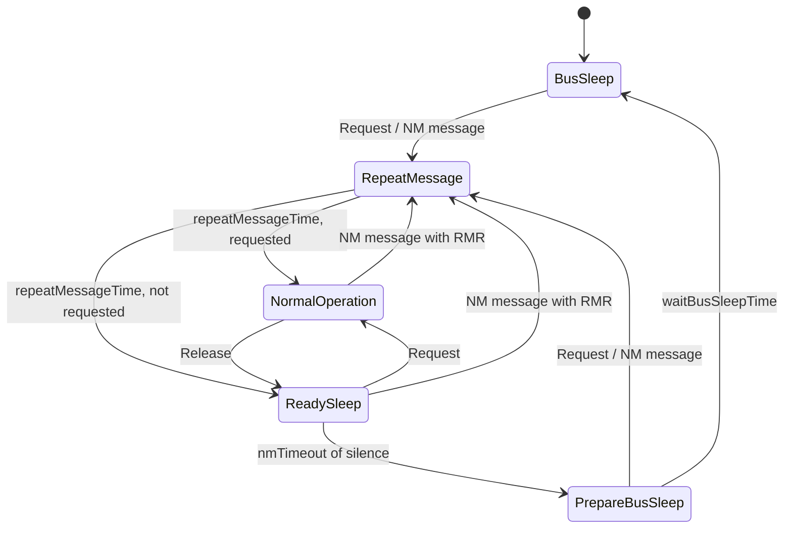

# ara::nm - Network Management

Transport-independent NM state machine in the style of AUTOSAR CAN-NM, one `NetworkHandle` per bus.
The handle never touches a bus: you feed it received NM messages and it hands back messages to send
through a callback, so it runs unchanged on CAN, Ethernet or in tests.

## API

| Type | Purpose |
|---|---|
| `NetworkManager` | registry: `CreateNetwork(name, cfg)`, `GetNetwork(name)`, `ProcessAll()` |
| `NetworkHandle` | `Request()/Release()`, `Request/ReleasePartialNetwork(id)`, `IsPartialNetworkRequested(id)`, `OnPduReceived()/OnBytesReceived()`, `Process()`, `SetStateChangeHandler()`, `SetTxHandler()` |
| `NmPdu` | 8 byte message: node id, control bits (RMR, PNI), 32 bit PN bitmap, 2 bytes user data |
| `NmClock` | injectable time source: `SteadyNmClock` (production), `ManualClock` (tests) |
| `NmErrc` | `kUnknownNetwork kNetworkExists kNotRequested kBadPdu kInvalidConfig` |

## Behaviour notes

* Timers only advance in public calls and `Process()`; a long gap walks every due transition at its exact deadline.
* Entering `RepeatMessage` transmits immediately; afterwards a message goes out every `messageCycleTime` in `RepeatMessage` and `NormalOperation`.
* `Request()` is idempotent; `Release()` without a request returns `kNotRequested`.
* Partial networks: a node transmits its local PN requests masked by `pnFilterMask`; remote requests are filtered by the same mask and expire after `pnResetTime`.
* Callbacks run without the internal lock, so they may call back into the handle.

## Not implemented

Real bus drivers (CAN/Ethernet), PN routing/aggregation between buses, the SWS `ara::nm` Adaptive facade (`NetworkHandle` naming from ara::com), NM coordinator, and wake-up/sleep indication towards `ara::exec`.
